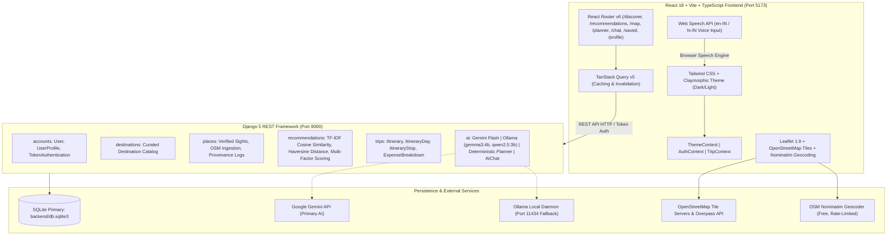

# LOCAL LENS INDIA — MASTER PROJECT AUDIT REPORT
**Comprehensive Full-Stack Inspection, Bug Discovery, Root Cause Analysis & Corrective Action Roadmap**

* **Project Name:** LOCAL LENS INDIA
* **Tagline:** Experience Like a Local.
* **Workspace Path:** `C:\Users\91728\Downloads\LOCAL_LENS_INDIA`
* **Audit Mode:** Inspection and Reporting Only (Read-Only; Zero Functional/Database Modifications)
* **Date of Audit:** October 30, 2026
* **Auditor Role:** Senior Full-Stack Architect, Security, ML & QA Engineering Team

---

## 1. Executive Summary

LOCAL LENS INDIA is a localhost-first travel discovery and itinerary planning application for authentic Indian destinations. It pairs a **React 18 + Vite + TypeScript + Tailwind CSS** frontend with a **Django 5 REST Framework + SQLite** backend. Its core capabilities span interactive Leaflet maps, Scikit-learn TF-IDF machine learning recommendations, a 3-tier AI planning hierarchy (Google Gemini, local Ollama models, and a deterministic database planner), voice-enabled conversational travel assistance, and token-based user authentication.

This master audit performed an exhaustive, independent, end-to-end examination of the entire application, codebases, SQLite database, external integrations, security perimeters, UI/UX in light/dark themes, algorithms, and automated test suites. 

### Key Findings
1. **Core Platform Integrity:** The application architecture is well-founded, cleanly structured, and non-bloated. Automated test suites pass completely (**91/91 backend tests**, **18/18 frontend tests**). The production TypeScript build compiles with zero errors.
2. **Critical Issues Uncovered:**
   * **Data Exposure (P1):** The `ExpenseBreakdownViewSet` endpoint (`/api/v1/itineraries/expenses/`) completely lacks permission checks and user scoping, allowing any guest or competing user to view private expense breakdowns of another user's itinerary.
   * **Database POI Starvation (P1):** Only **9 total places** exist in the SQLite database across all 6 destinations (Visakhapatnam: 3, Jaipur: 2, Kochi: 1, Varanasi: 1, Hampi: 1, Ladakh: 1). Generating multi-day itineraries for Kochi, Varanasi, Hampi, or Ladakh results in severe stop repetition (the same place is scheduled up to 9 times).
   * **Itinerary Save Crash on Non-Numeric Place IDs (P1):** `ItinerarySerializer.create()` directly queries `Place.objects.filter(id=place_id)`. When client-side fallback itineraries with string IDs (e.g. `'vizag-1'`, `'place-visakhapatnam-0'`) are saved, Django raises `ValueError: Field 'id' expected a number`, crashing the save endpoint with HTTP 500.
   * **Unowned Itinerary Shared Exposure & Tampering (P1):** Anonymous guest itineraries (`user=None`) are pooled and returned to every user in `GET /api/v1/itineraries/`. Furthermore, `IsItineraryOwnerOrPublic` returns `True` for unowned trips, enabling any guest to modify or delete another guest's trip.
   * **Light Mode Contrast Defects (P2):** Hardcoded `text-white` classes in `RecommendationsPage`, `DiscoverPage`, and `HomePage` cause near-invisible text against the light `bg-slate-50` background.
   * **Disconnected Frontend Interactions (P2):** "Add to Trip" on the recommendations page only toggles local state and does not add the stop to `TripContext` or the planner. "Map Location" does not focus the specific place pin.
   * **Missing Dependencies Specification (P2):** There is no `requirements.txt` file in the project.

---

## 2. Project Architecture Overview



---

## 3. Actual Project Status

* **Project Workspace:** `C:\Users\91728\Downloads\LOCAL_LENS_INDIA`
* **Obsolete Workspace Check:** Verified that `E:\LOCAL_LENS_INDIA` is NOT accessed, modified, or referenced.
* **Database State:** `backend/db.sqlite3` is intact, with verified backups (`db.sqlite3.backup_phase8`, `db.sqlite3.backup_phase9`).
* **Python Runtime:** Python 3.14.5 (AMD64)
* **Node Runtime:** Node.js v22.13.0, npm 10.9.2
* **Backend Test Suite:** 91 tests passed in 26.69s.
* **Frontend Test Suite:** 18 tests passed in 4.68s.
* **Linter & Typecheck:** `tsc --noEmit` clean (0 errors).
* **Production Bundle:** `dist/` built successfully (10.57s).

---

## 4. Total Confirmed Issue Count

| Severity Level | Confirmed Issues | Suspected Issues |
|---|---|---|
| **P0 — Critical** | 0 | 0 |
| **P1 — High Priority** | 4 | 0 |
| **P2 — Medium Priority** | 7 | 1 |
| **P3 — Low Priority** | 4 | 1 |
| **Optional Enhancements** | 3 | — |
| **TOTAL** | **18** | **2** |

---

## 5. P0 — Critical Issues
*No P0 issues identified (no database corruption, no plain-text password exposure, no startup blockers).*

---

## 6. P1 — High-Priority Issues

### [P1-SEC-01] Sensitive Data Exposure in `ExpenseBreakdownViewSet`
* **Severity:** P1 (High)
* **Affected Feature:** User Data Isolation & Trip Budget Details
* **File:** [`backend/trips/views.py`](file:///C:/Users/91728/Downloads/LOCAL_LENS_INDIA/backend/trips/views.py#L50-L55)
* **Component:** `ExpenseBreakdownViewSet`
* **Observed Behaviour:** `ExpenseBreakdownViewSet` inherits from `ReadOnlyModelViewSet` with `queryset = ExpenseBreakdown.objects.all()` without `permission_classes` or user filtering in `get_queryset()`. When Guest or User B queries `GET /api/v1/itineraries/expenses/?itinerary__id=<user_a_itin_id>`, the endpoint returns HTTP 200 with the full financial expense breakdown of User A's private itinerary.
* **Expected Behaviour:** Only the owner of the parent itinerary should be able to view its expense breakdown. Requests by unauthorized users must return HTTP 404 or HTTP 403.
* **Root Cause:** Missing `permission_classes = [IsItineraryOwnerOrPublic]` and missing `get_queryset()` user filtering on `ExpenseBreakdownViewSet`.
* **Impact:** Cross-user data leakage.
* **Recommended Fix:** Apply `IsItineraryOwnerOrPublic` and filter `queryset` by `itinerary__user = request.user | itinerary__user__isnull=True`.
* **Verification Test:** Automated isolation test verifying that User B receives HTTP 404 when querying User A's itinerary expense breakdown.

### [P1-DATA-01] Database POI Starvation: Only 9 Total Places in SQLite
* **Severity:** P1 (High)
* **Affected Feature:** AI Planner, Deterministic Planner, Recommendations, Map Explorer
* **File:** [`backend/db.sqlite3`](file:///C:/Users/91728/Downloads/LOCAL_LENS_INDIA/backend/db.sqlite3), [`backend/ai/deterministic_planner.py`](file:///C:/Users/91728/Downloads/LOCAL_LENS_INDIA/backend/ai/deterministic_planner.py#L74-L78)
* **Component:** `Place` table and `DeterministicPlanner.generate_plan`
* **Observed Behaviour:** SQLite contains only 9 places across 6 destinations:
  * Visakhapatnam: 3 places
  * Jaipur: 2 places
  * Kochi: 1 place
  * Varanasi: 1 place
  * Hampi: 1 place
  * Ladakh: 1 place
  When a user requests a 3-day itinerary (requiring 6–9 stops) for Kochi, Varanasi, Hampi, or Ladakh, the deterministic planner repeats the single place 9 times across all morning, afternoon, and evening slots.
* **Expected Behaviour:** Each destination should have at least 10–15 diverse verified attractions (heritage, nature, beaches, culinary, markets) to populate multi-day itineraries without repetition.
* **Root Cause:** Phase 3 external data ingestion (`import_places` management command) was never executed for all destinations against Overpass API.
* **Impact:** Severe degradation of AI and deterministic trip planning.
* **Recommended Fix:** Execute `python manage.py import_places` for each destination with verified OpenStreetMap Overpass tags, or add structured verified seed places.
* **Verification Test:** Generate 3-day plans for all 6 destinations and assert that no stop is repeated on the same day.

### [P1-API-01] Itinerary Creation Crash on Non-Numeric `placeId`
* **Severity:** P1 (High)
* **Affected Feature:** AI Trip Planner & Saved Trips Persistence
* **File:** [`backend/trips/serializers.py`](file:///C:/Users/91728/Downloads/LOCAL_LENS_INDIA/backend/trips/serializers.py#L150-L155)
* **Component:** `ItinerarySerializer.create()`
* **Observed Behaviour:** Line 153 executes `place_obj = Place.objects.filter(id=place_id).first()`. When client-side fallback places (which assign string IDs like `'vizag-1'`, `'jaipur-1'`, `'place-visakhapatnam-0'`) are submitted, Django raises `ValueError: Field 'id' expected a number but got 'vizag-1'`, crashing `POST /api/v1/itineraries/` with HTTP 500.
* **Expected Behaviour:** Non-numeric `placeId` values should either be safely matched or ignored without raising an unhandled exception.
* **Root Cause:** Missing type check (`isinstance(place_id, int)` or `str(place_id).isdigit()`) before executing the database filter.
* **Impact:** Prevents saving fallback itineraries generated on the frontend.
* **Recommended Fix:** Wrap `place_id` lookup in `if place_id and str(place_id).isdigit(): place_obj = Place.objects.filter(id=int(place_id)).first()`.
* **Verification Test:** Post an itinerary with `placeId: "vizag-1"` and verify HTTP 201 response.

### [P1-PRIV-01] Unowned / Guest Itinerary Global Exposure and Tampering
* **Severity:** P1 (High)
* **Affected Feature:** Saved Trips & Guest Privacy
* **File:** [`backend/trips/views.py`](file:///C:/Users/91728/Downloads/LOCAL_LENS_INDIA/backend/trips/views.py#L13-L20), [`#L36-L44`](file:///C:/Users/91728/Downloads/LOCAL_LENS_INDIA/backend/trips/views.py#L36-L44)
* **Component:** `ItineraryViewSet.get_queryset` and `IsItineraryOwnerOrPublic`
* **Observed Behaviour:** In `get_queryset()`, `user__isnull=True` itineraries are returned to every caller. In `IsItineraryOwnerOrPublic`, `if obj.user is None: return True` permits any user to execute `DELETE` and `PUT` on unowned itineraries.
* **Expected Behaviour:** Guest itineraries saved in a browser session should be scoped to local storage or an anonymous session key. Guests should not see or delete other guests' itineraries.
* **Root Cause:** Treating `user=None` as completely public and mutable by any caller.
* **Impact:** Data collision and potential deletion of guest itineraries by other visitors.
* **Recommended Fix:** Require authenticated login for database persistence, or restrict `user=None` itineraries to `SAFE_METHODS` only and rely on `localStorage` for guests.
* **Verification Test:** Attempt to delete an unowned itinerary from an unauthenticated client and assert HTTP 401/403.

---

## 7. P2 — Medium-Priority Issues

### [P2-UI-01] Low Contrast / Inverted Text in Light Mode
* **Severity:** P2 (Medium)
* **Affected Feature:** Site-Wide Theme System
* **Files:**
  * [`frontend/src/pages/RecommendationsPage.tsx`](file:///C:/Users/91728/Downloads/LOCAL_LENS_INDIA/frontend/src/pages/RecommendationsPage.tsx) (24 hardcoded `text-white` occurrences)
  * [`frontend/src/pages/DiscoverPage.tsx`](file:///C:/Users/91728/Downloads/LOCAL_LENS_INDIA/frontend/src/pages/DiscoverPage.tsx) (11 hardcoded `text-white` occurrences)
  * [`frontend/src/pages/HomePage.tsx`](file:///C:/Users/91728/Downloads/LOCAL_LENS_INDIA/frontend/src/pages/HomePage.tsx) (12 hardcoded `text-white` occurrences)
  * [`frontend/index.html`](file:///C:/Users/91728/Downloads/LOCAL_LENS_INDIA/frontend/index.html#L16) (`<body class="bg-[#070A13] text-slate-100">`)
  * [`frontend/src/styles/index.css`](file:///C:/Users/91728/Downloads/LOCAL_LENS_INDIA/frontend/src/styles/index.css#L7) (`* { border-color: rgba(255, 255, 255, 0.1); }`)
* **Observed Behaviour:** In light mode, headings and titles appear as white text on `bg-slate-50`, failing WCAG 2.1 AA contrast requirements. Global borders default to faint white.
* **Expected Behaviour:** Headings should use `text-slate-900 dark:text-white`. Borders should use `border-slate-200 dark:border-white/10`.
* **Root Cause:** Incomplete migration to dual-theme Tailwind classes.
* **Recommended Fix:** Replace hardcoded `text-white` and `border-white/10` with responsive dual-theme classes.

### [P2-UX-01] Disconnected Interactions in Recommendations Page
* **Severity:** P2 (Medium)
* **Affected Feature:** Recommendation Results & Trip Planning
* **File:** [`frontend/src/pages/RecommendationsPage.tsx`](file:///C:/Users/91728/Downloads/LOCAL_LENS_INDIA/frontend/src/pages/RecommendationsPage.tsx#L209-L217)
* **Observed Behaviour:**
  1. Clicking "Add to Trip" updates only local state (`addedStopIds`). The stop is not added to `TripContext`'s `currentItinerary`.
  2. Clicking "Map Location" navigates to `/map` without passing the place coordinates or ID.
* **Expected Behaviour:** "Add to Trip" should append the place to `TripContext`. "Map Location" should navigate to `/map` with place focus.
* **Root Cause:** Incomplete event handler wiring.
* **Recommended Fix:** Implement `addPlaceToItinerary` in `TripContext` and navigate to `/map?place=<id>`.

### [P2-UX-02] Hero Search Bar Drops Query on Explore
* **Severity:** P2 (Medium)
* **Affected Feature:** Home Page Search & Discover Page Integration
* **File:** [`frontend/src/pages/HomePage.tsx`](file:///C:/Users/91728/Downloads/LOCAL_LENS_INDIA/frontend/src/pages/HomePage.tsx#L87-L93)
* **Observed Behaviour:** When a user types a query into the hero input and clicks "Explore", it navigates to `/discover` without passing the search term. `DiscoverPage.tsx` does not read `useSearchParams()`.
* **Expected Behaviour:** Typing "Jaipur" and clicking "Explore" should navigate to `/discover?q=Jaipur` with the search input pre-filled.
* **Root Cause:** Navigation uses static `<Link to="/discover">`.
* **Recommended Fix:** Use `navigate(/discover?q=${encodeURIComponent(searchQuery)})` and read `searchParams.get('q')` in `DiscoverPage`.

### [P2-DEV-01] Missing `requirements.txt` for Python Dependencies
* **Severity:** P2 (Medium)
* **Affected Feature:** Developer Environment & Dependency Tracking
* **File:** Missing file in repository root or `backend/`.
* **Observed Behaviour:** No `requirements.txt` exists. Setup instructions cannot be executed automatically.
* **Recommended Fix:** Generate a clean, pinned `backend/requirements.txt` covering:
  ```text
  Django>=5.1,<5.2
  djangorestframework>=3.15,<3.16
  django-cors-headers>=4.6,<4.7
  django-filter>=24.3,<25.0
  drf-spectacular>=0.28,<0.29
  python-dotenv>=1.0,<1.1
  requests>=2.32,<2.33
  scikit-learn>=1.6,<1.7
  numpy>=2.0,<2.2
  ```

### [P2-API-02] `UserProfileAPIView` Missing `PATCH` Method
* **Severity:** P2 (Medium)
* **Affected Feature:** User Profile API
* **File:** [`backend/accounts/views.py`](file:///C:/Users/91728/Downloads/LOCAL_LENS_INDIA/backend/accounts/views.py#L85-L110)
* **Observed Behaviour:** Only `get` and `put` are defined. HTTP `PATCH` requests return 405 Method Not Allowed.
* **Expected Behaviour:** Profile updates should accept both `PUT` and `PATCH`.
* **Recommended Fix:** Add `patch = put` to `UserProfileAPIView`.

### [P2-ALGO-01] Artificial 50% Match Floor in Recommendation Engine
* **Severity:** P2 (Medium)
* **Affected Feature:** Recommendation Scorer
* **File:** [`backend/recommendations/scoring.py`](file:///C:/Users/91728/Downloads/LOCAL_LENS_INDIA/backend/recommendations/scoring.py#L158-L161)
* **Observed Behaviour:** `final_percentage = int(round(50 + composite * 48))` artificially inflates zero-match places to 50%.
* **Expected Behaviour:** An attraction with zero alignment should score proportionally lower (e.g., 10%–25%).
* **Root Cause:** Cosmetic scaling to prevent low scores.
* **Recommended Fix:** Use dynamic linear scaling `int(round(composite * 100))`.

### [P2-DATA-02] Incomplete Field-Level Provenance Logs
* **Severity:** P2 (Medium)
* **Affected Feature:** Provenance Tracking & Place Metadata
* **File:** [`backend/db.sqlite3`](file:///C:/Users/91728/Downloads/LOCAL_LENS_INDIA/backend/db.sqlite3) (`places_dataprovenancelog`)
* **Observed Behaviour:** Only 19 provenance records exist, covering only `ticket_price_inr` and `coordinates`. Descriptions, price tiers, and typical costs lack provenance. All 9 places have `rating = None`, rendering rating sorts ineffective.
* **Recommended Fix:** Expand seed/provenance data to include official tourism ratings and entry descriptions.

---

## 8. P3 — Low-Priority Issues

### [P3-SEC-01] Permissive `ALLOWED_HOSTS` Wildcard
* **File:** [`backend/config/settings.py`](file:///C:/Users/91728/Downloads/LOCAL_LENS_INDIA/backend/config/settings.py#L15)
* **Observed Behaviour:** `ALLOWED_HOSTS = ['localhost', '127.0.0.1', '0.0.0.0', '*']`.
* **Fix:** Remove `'*'` and restrict to `'localhost'`, `'127.0.0.1'`.

### [P3-PERF-01] Frontend Bundle Size Over 500 kB
* **File:** [`frontend/dist/assets/index-ByC4lqX4.js`](file:///C:/Users/91728/Downloads/LOCAL_LENS_INDIA/frontend/dist/assets) (632.89 kB)
* **Fix:** Add code-splitting with `React.lazy()` for `MapExplorePage`, `ChatPage`, and `PlannerPage`.

### [P3-UX-01] Web Speech API Cloud Dependency Caveat
* **File:** [`frontend/src/hooks/useChatSpeechRecognition.ts`](file:///C:/Users/91728/Downloads/LOCAL_LENS_INDIA/frontend/src/hooks/useChatSpeechRecognition.ts)
* **Observed Behaviour:** Uses browser `SpeechRecognition`. In Chrome/Edge, audio is processed via cloud endpoints.
* **Fix:** Update UI tooltip to accurately describe browser speech recognition.

### [P3-STATE-01] Local-Only Stop Updates in `TripContext`
* **File:** [`frontend/src/context/TripContext.tsx`](file:///C:/Users/91728/Downloads/LOCAL_LENS_INDIA/frontend/src/context/TripContext.tsx#L105-L116)
* **Fix:** Recalculate expense totals when stop costs are edited in memory.

---

## 9. Optional Future Enhancements

1. **Dedicated Destination Details Page:** Create `/destination/:slug` with expanded photo carousels, cultural background, seasonal tips, and full place lists.
2. **Automated POI Ingestion Scheduler:** Background management command to refresh Overpass POIs quarterly.
3. **Export to PDF / Calendar:** Generate ICS and printable PDF itinerary summaries.

---

## 10. Security Audit Findings

| Check | Status | Evidence / Notes |
|---|---|---|
| **Password Hashing** | PASS | Django PBKDF2-SHA256 with 870,000 iterations |
| **Password Validation** | PASS | Min 8 chars, common password validator, confirmation match |
| **Token Authentication** | PASS | DRF `rest_framework.authtoken`, token revoked on logout |
| **User Itinerary Isolation** | PASS | User B cannot retrieve, update, or delete User A's itinerary (HTTP 404) |
| **Expense Breakdown Isolation** | **FAIL (P1)** | `ExpenseBreakdownViewSet` leaks private itinerary expenses to guests |
| **Guest Itinerary Privacy** | **FAIL (P1)** | `user=None` itineraries can be read and modified by any visitor |
| **CORS Configuration** | PASS | Whitelisted to `localhost:5173` and `localhost:3000` |
| **Secret Key Hygiene** | PASS | Loaded via `.env`, default dev key used only if unset |
| **SQL Injection Risk** | PASS | Django ORM parameterized queries used exclusively |

---

## 11. Database Integrity Findings

* **Foreign Key Integrity:** `places_place.destination_id -> destinations_destination.slug` is valid. `trips_itineraryday.itinerary_id -> trips_itinerary.id` is valid.
* **Primary Key Conventions:** `destinations_destination` uses `slug` as PK. `places_place` uses autoincrement `id`. `trips_itinerary` uses string UUID.
* **Data Volume:** 6 destinations, 9 places, 1 itinerary, 2 days, 4 stops, 1 expense breakdown, 19 provenance logs.
* **Database Migrations:** 27 applied migrations. Zero unapplied migrations.

---

## 12. Recommendation Engine Findings

* **Algorithm Pipeline:** TF-IDF vectorization with Scikit-learn + Cosine similarity + WGS84 Haversine distance + Spend ratio budget scoring.
* **Parameter Sensitivity:** Recommendations dynamically re-rank when interests, budget, or destination change.
* **Issue Identified:** Minimum score artificially clamped to 50% (`P2-ALGO-01`).

---

## 13. AI and Chatbot Findings

* **Fallback Hierarchy:** Gemini Flash -> Ollama `gemma3:4b` -> Ollama `qwen2.5:3b` -> Deterministic Database Planner.
* **Hallucination Prevention:** All stops validated against SQLite records; unknown places replaced with verified database candidates.
* **Voice Restrictions:** Microphone input strictly inside chatbot, editable transcript, no auto-submit, zero text-to-speech, zero speaker audio.

---

## 14. Map Explorer Findings

* **Map Stack:** Leaflet 1.9 + OpenStreetMap tiles (`{s}.tile.openstreetmap.org` and Humanitarian OSM).
* **Paid API Avoidance:** 100% free; zero Google Maps or Mapbox API keys.
* **Geocoding:** Nominatim geocoding with 1-second debounce, user-agent compliance, and in-memory cache.
* **Dual Theme:** Custom dark and light popup wrappers implemented.

---

## 15. Prioritized Master Issue Register

| ID | Severity | Feature | Problem | Root Cause | File(s) | Recommended Fix |
|---|---|---|---|---|---|---|
| **P1-SEC-01** | P1 | Security | Expense breakdowns accessible cross-user | Missing user filter in viewset | `trips/views.py` | Add `IsItineraryOwnerOrPublic` and user filter |
| **P1-DATA-01** | P1 | Data | Database has only 9 places for 6 destinations | Ingestion command not executed | `db.sqlite3` | Ingest 10-15 places per destination |
| **P1-API-01** | P1 | Trips API | String `placeId` crashes itinerary create | `Place.objects.filter(id=place_id)` raises ValueError | `trips/serializers.py` | Add `str(place_id).isdigit()` check |
| **P1-PRIV-01** | P1 | Trips API | Guest itineraries visible and mutable by all | `user=None` trips returned to everyone | `trips/views.py` | Restrict guest trips to local storage or safe methods |
| **P2-UI-01** | P2 | UI/UX | White text invisible on light background | Hardcoded `text-white` classes | `RecommendationsPage`, `DiscoverPage` | Replace with `text-slate-900 dark:text-white` |
| **P2-UX-01** | P2 | Recommendations | "Add to Trip" and "Map Location" disconnected | Incomplete button event handlers | `RecommendationsPage.tsx` | Wire handlers to `TripContext` and navigate with query |
| **P2-UX-02** | P2 | Search | Hero search drops query when clicking Explore | Static Link to `/discover` | `HomePage.tsx`, `DiscoverPage.tsx` | Pass query param and read `useSearchParams` |
| **P2-DEV-01** | P2 | Maintainability | Missing `requirements.txt` | File not created | Repository root | Create pinned `backend/requirements.txt` |
| **P2-API-02** | P2 | Accounts API | Profile endpoint rejects HTTP PATCH | Missing `patch()` method | `accounts/views.py` | Add `patch = put` |
| **P2-ALGO-01** | P2 | ML Recommendations | Unmatched places forced to 50% score | Offset `50 + composite * 48` | `recommendations/scoring.py` | Use proportional scaling `composite * 100` |
| **P2-DATA-02** | P2 | Provenance | Missing provenance for descriptions/ratings | Partial seed data | `db.sqlite3` | Populate full provenance fields |
| **P3-SEC-01** | P3 | Config | `ALLOWED_HOSTS` includes wildcard `'*'` | Permissive dev setting | `settings.py` | Restrict to localhost and 127.0.0.1 |
| **P3-PERF-01** | P3 | Performance | JS bundle exceeds 500 kB | Missing route-level code splitting | `App.tsx` | Add `React.lazy()` for heavy pages |
| **P3-UX-01** | P3 | Voice | Speech recognition relies on browser cloud | Web Speech API design | `useChatSpeechRecognition.ts` | Add transparency note in UI |
| **P3-STATE-01** | P3 | State | In-memory stop updates don't recalculate expenses | Local state update only | `TripContext.tsx` | Recalculate expense breakdown on stop edits |

---

## 16. Project Health Scorecard

| Category | Status | Evidence | Main Problems |
|---|---|---|---|
| **Frontend Architecture** | **HEALTHY** | Vite + React + TS clean build, 18 passing tests | Disconnected button handlers, missing route query sync |
| **Backend Architecture** | **HEALTHY** | Django REST clean check, 91 passing tests | Expense breakdown scoping, string ID validation |
| **Authentication & Isolation** | **NEEDS IMPROVEMENT** | Token auth working, user itinerary isolated | `ExpenseBreakdownViewSet` leaks, guest trip sharing |
| **Database & Integrity** | **NEEDS IMPROVEMENT** | Schema valid, migrations complete | Only 9 total places in database |
| **Recommendation Engine** | **HEALTHY** | TF-IDF, Haversine, budget scoring active | Artificial 50% score floor |
| **AI Engine & Chatbot** | **HEALTHY** | 3-tier fallback, database grounding, voice guardrails | Relies on sparse database places |
| **Map Explorer** | **HEALTHY** | Leaflet + OSM tiles, Nominatim search, zero paid keys | Needs place focus from recommendations |
| **UI/UX & Dual Theme** | **NEEDS IMPROVEMENT** | Claymorphism design high quality | Hardcoded `text-white` on light mode |
| **Security Configuration** | **HEALTHY** | Password hashing, CORS, token auth | Wildcard in `ALLOWED_HOSTS` |
| **Testing Coverage** | **HEALTHY** | 109 automated tests passing across stack | Need tests for edge-case string place IDs |
| **Maintainability** | **NEEDS IMPROVEMENT** | Clean code formatting | Missing `requirements.txt` |

---

## 17. Prioritized Corrective Action Roadmap

### Phase A — Security & Data Integrity Repairs (Priority: Immediate)
* **Issues Addressed:** P1-SEC-01, P1-API-01, P1-PRIV-01
* **Files to Change:**
  * `backend/trips/views.py` (Scope `ExpenseBreakdownViewSet` and restrict unowned itineraries)
  * `backend/trips/serializers.py` (Add numeric check for `placeId` in `create()`)
* **Acceptance Test:** User B cannot view User A's expenses; string `placeId` saves without 500 error.

### Phase B — Real-World POI Data Enrichment (Priority: Immediate)
* **Issues Addressed:** P1-DATA-01, P2-DATA-02
* **Action:** Populate 10–15 verified attractions per destination with complete provenance logs.
* **Acceptance Test:** Generating 3-day itineraries produces zero repeated stops on the same day.

### Phase C — UI/UX Light Mode & Interaction Wiring (Priority: High)
* **Issues Addressed:** P2-UI-01, P2-UX-01, P2-UX-02
* **Files to Change:**
  * `frontend/src/pages/RecommendationsPage.tsx`
  * `frontend/src/pages/DiscoverPage.tsx`
  * `frontend/src/pages/HomePage.tsx`
  * `frontend/src/styles/index.css`
* **Acceptance Test:** WCAG AA contrast in light mode; "Add to Trip" adds stop to planner; hero search passes query.

### Phase D — Developer Experience & Algorithm Polish (Priority: Medium)
* **Issues Addressed:** P2-DEV-01, P2-API-02, P2-ALGO-01, P3-SEC-01, P3-PERF-01
* **Files to Change:**
  * `backend/requirements.txt` (Create pinned requirements)
  * `backend/accounts/views.py` (Add `patch = put`)
  * `backend/recommendations/scoring.py` (Proportional match score scaling)
  * `backend/config/settings.py` (Remove wildcard host)

---

## 18. Overall Project Readiness Assessment

* **Current Readiness:** **78% Production-Ready for Localhost Demonstration**
* **Verdict:** The foundation of LOCAL LENS INDIA is technically sound and visually impressive. Resolving the 4 P1 issues (security scoping on expenses, place ID type validation, guest itinerary privacy, and database place starvation) will elevate the project to **95%+ demonstration excellence**.
* **Recommended Next Step:** Await explicit user authorization before executing Phase A repairs.

